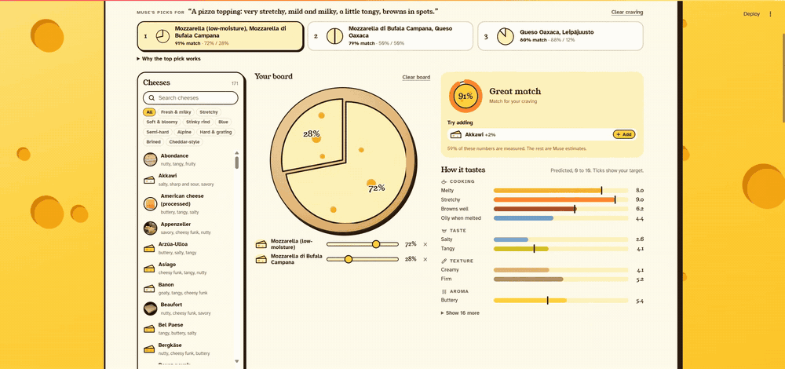
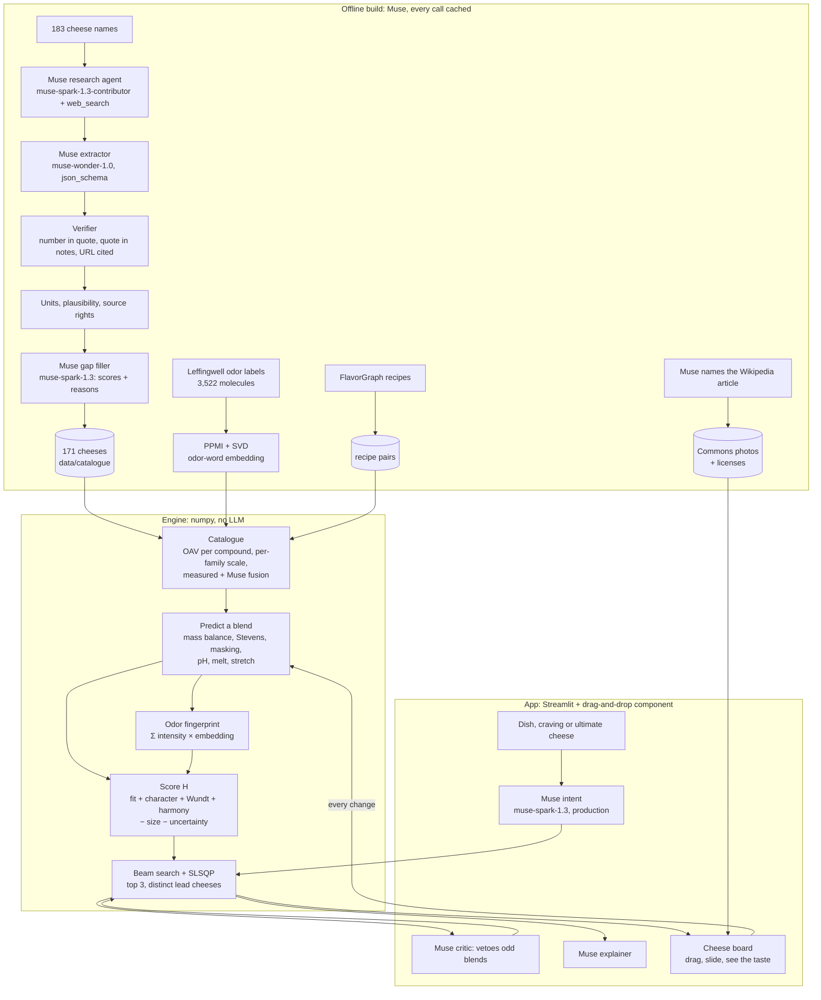

# CheeseBlend

**The right cheese blend for whatever you're making, predicted from the flavour chemistry of 171 cheeses. Built on Meta Muse.**

**Live app:** LIVE_URL · **Video demo:** [docs/demo.mp4](docs/demo.mp4) · **Research and Muse write-up:** [docs/RESEARCH.md](docs/RESEARCH.md)



Every output is a model prediction. No health or nutrition claims.

## What it is

Cooks blend cheeses all the time: Gruyère with Vacherin for fondue, mozzarella with provolone for pizza. They do it by feel. CheeseBlend does it from chemistry.

- **The research.** Muse read the published flavour chemistry of 171 cheeses: which aroma compounds each contains and how much, plus salt, fat, moisture and acidity, with a source for every number.
- **The prediction.** For any mix, the engine predicts how it will taste, smell and cook (melty? stretchy? nutty? funky?), using published models of how mixtures of odors are perceived.
- **The search.** Tell it what you're making and it tries every blend of up to 4 cheeses to find the best one. Then Muse checks that the result makes culinary sense and explains why it works.

## Using it

1. **Pick a dish** (fondue, pizza, grilled cheese), **ask Muse** with your own craving, or tap **Make the ultimate cheese**, the theoretically best blend under the model.
2. Muse's top 3 blends appear as cheese wheels, and the best one goes onto your **board**.
3. **Drag cheeses** from the shelf onto the board (or tap them) and **slide the shares**. The taste read-out updates instantly: the match to your craving, what it still needs ("more creamy 4.9 → 8"), one-tap cheeses that would get it closer, what it smells like, and the molecules you'd smell first.
4. **Go deeper** for the odor maps, every cheese's numbers and sources, and the accuracy test.

## Architecture



## How the prediction works

1. **Mix.** Blend odor activity values (OAV = concentration / odor threshold) by mass balance per aroma family.
2. **Perceive.** Stevens' power law (n = 0.5), zero below threshold, then a per-family scale so 10 means "as intense as any cheese gets".
3. **Mask.** Weaker families are suppressed relative to the strongest: `F = I·(I/max I)^m`.
4. **Taste and function.** Salt and umami mix linearly; pH mixes by [H⁺]. A non-melter breaks the melt around it (`-p·w(1-w)`). Stretch switches on once there is enough pasta filata (sigmoid gate).
5. **Embed.** Every compound is a vector in an odor-word embedding (below). A blend's odor fingerprint is the intensity-weighted sum of its compounds' vectors.
6. **Score.** `H = Fit + β·Wundt + γ·Harmony − λ·(n−1) − μ·Uncertainty`. Fit uses a bliss point per target dimension, plus an aroma-character term: the cosine between the blend's fingerprint and the target's. Wundt rewards moderate aroma complexity (about 3.5 effective families). Harmony is shared compounds (cosine of fingerprints) plus recipe co-occurrence.
7. **Search.** Candidates are the providers for each high-importance dimension plus the best solo cheeses. Beam search over subsets of up to 4, with every share vector on a 5% grid scored in one numpy batch. The finalists get an SLSQP polish, and the top 3 each lead with a different cheese.

"Mix everything" loses: averaging pulls every dimension toward the catalogue mean, and big mixes converge on one generic "cheese white" odor (Weiss et al. 2012). It loses even with the size penalty λ removed.

## Compound embeddings and cosine

- **Odor space.** The Leffingwell dataset labels 3,522 molecules with 113 odor words. We count how often two words label the same molecule, take positive pointwise mutual information and keep the top 24 SVD dimensions. SVD on PPMI is the classic word-embedding recipe and matches word2vec in quality (Levy & Goldberg 2014). Nearest neighbours come out right: *buttery* → creamy, milky, dairy; *nutty* → roasted, hazelnut, coffee; *smoky* → phenolic, leathery.
- **Compounds.** Each of the 33 key cheese odorants is the normalized mean of its Leffingwell words. 30 are matched by PubChem CID; the two goaty acids and ammonia aren't in Leffingwell and are labelled by hand.
- **Mixtures.** A mixture is the sum of its components' vectors, and perceptual similarity tracks the angle between mixture vectors. Snitz et al. (2013) introduced this, and Ravia et al. (2020) validated it on 49,788 similarity judgments and used it to build olfactory metamers. We weight components by perceived intensity, because cheese compounds aren't intensity-matched.
- **Cheese white.** Weiss et al. (2012) found that mixtures of about 30 components converge on one percept, "olfactory white". Our data reproduces it: random single cheeses sit 0.33 rad apart, random 32-cheese mixes 0.08 rad apart. The white they converge on is the catalogue's average fingerprint.
- **Centered cosine.** Every cheese shares a big cheesy/buttery direction, so raw cosine sits at 0.5-0.95 for everything. Character is measured after subtracting the cheese white: does this blend depart from the average cheese the way the target does?

## Research basis

What is published, what is published data, and what is our assumption:

| Piece | Basis | Status |
|---|---|---|
| Odor activity value = concentration / threshold | Rothe & Thomas 1963; Grosch 2001. Key cheese odorants by GC-olfactometry: Curioni & Bosset 2002 | Published method |
| Concentrations mix by mass balance | Physics | Standard |
| Stevens' power law for odor intensity | Stevens 1957; odor exponents 0.2-0.7 (Cain 1969) | Published law. n = 0.5 is our pick |
| Stronger odors suppress weaker ones | Mixture suppression: Cain & Drexler 1974; Laing & Willcox 1983 | Published effect. The formula `I·(I/max)^m` is ours |
| Odor-word embedding | Leffingwell labels (Sanchez-Lengeling et al. 2019); PPMI + SVD (Levy & Goldberg 2014); same label space as the Principal Odor Map (Lee et al. 2023) | Published data and method |
| Mixture = sum of vectors, similarity = angle | Snitz et al. 2013; Ravia et al. 2020 | Published model. Intensity weighting is our extension |
| Big mixes converge ("white") | Weiss et al. 2012 | Published finding, reproduced in our data |
| Harmony from shared compounds | Food-pairing hypothesis, Ahn et al. 2011 (holds for Western cuisines, not East Asian) | Published hypothesis |
| Harmony from recipes | FlavorGraph ingredient NPMI over about 1M recipes (Park et al. 2021) | Published data |
| Moderate complexity is liked most | Wundt curve, Berlyne 1971 | Published concept. Peak at 3.5 families is ours |
| Each dimension has an ideal level | Bliss point, Moskowitz 1972 | Published concept. Width is ours |
| pH of a blend from [H⁺] | Chemistry | Ignores buffering |
| Melt break, stretch gate, per-family scale, measured/Muse fusion | Ours | Assumptions, documented below |

## Meta models used

| Role | Model | How |
|---|---|---|
| Research agent | `muse-spark-1.3-contributor` | Responses API + `web_search`, one cheese per call |
| Extractor | `muse-wonder-1.0` | `json_schema`, exact quote per number |
| Verifier | code | number in its quote, quote in the notes, URL among the search citations |
| Gap filler | `muse-spark-1.3` | 0-10 score + chemical reason for each dimension without measured data |
| Intent parser | `muse-spark-1.3` | craving → target profile, never names a cheese |
| Critic | `muse-spark-1.3` | culinary sanity check → exclusion → re-optimize (max 2 rounds) |
| Explainer | `muse-spark-1.3` | why the blend works, using only the numbers and sources given |

## The catalogue

171 cheeses across 10 styles, 642 cited sources. 66 cheeses have measured aroma compounds (483 values); 532 of 684 composition values (moisture, fat, salt, pH) are measured. Odor thresholds in water: 30 of 33 compounds, from the Leffingwell compilation. Everything else is a Muse gap-filler score with a one-line chemical reason, flagged `inferred`. Confidence per cheese runs 0.30 to 0.84.

183 cheeses were attempted. Muse's content filter refused 12 of them, every time, for no visible reason (Maroilles, Cabrales, Stinking Bishop and others), so they're left out.

## The app

- **Cheese board.** This is the main stage: a drag-and-drop component (`cheeseboard/index.html`, plain JS, no build step). Drag cheeses from the shelf onto a wooden board, or tap them. Shares are sliders, and the cheese wheel redraws live. Every change goes back to the Python engine. *How it tastes* shows plain-language bars with the craving's targets marked, *Smells most like* lists the nearest cheeses by cosine, and *Key aroma molecules* shows what you'd smell first.
- **Cravings.** Pick a dish (precomputed with Muse), or type a craving and *Ask Muse* live. You get the top 3 blends as cheese wheels; tap one to put it on the board. Live cravings are user text, so they go to the production Muse tier only (`muse-spark-1.3`). The contributor tier, where Meta trains on prompts, is used only for offline research on public papers.
- **Make the ultimate cheese.** No Muse call: the engine tries every blend of up to 4 of the 171 cheeses against a hand-picked ideal crowd-pleaser (deeply savory and nutty, melts, buttery, a touch of fruit, no ammonia). The ideal shows as ticks on the taste bars.
- **Real photos.** Muse names each cheese's English Wikipedia article, Wikipedia supplies the lead photo, and Wikimedia Commons supplies the license and author (`scripts/build_images.py`). Only freely licensed Commons photos are kept. Images are linked, not copied, with credit on hover; cheeses without a free photo keep the drawn wedge.
- **Go deeper.** Odor-space and cheese-space maps for whatever is on the board, search by smell words, every cheese's numbers and sources, and the backtest.

## Results

Backtest: anonymous dish descriptions (no cheese or dish names) → Muse intent → engine → top 3. The held-out blend is removed from harmony co-occurrence and the critic is off, so neither can steer to the answer. A hit is Jaccard ≥ 0.5 between the human blend and any of the top 3.

| Catalogue | Split | Blends | Exact hit@3 | Style hit@3 |
|---|---|---|---|---|
| 30 cheeses | Train (pizza, mac and cheese, cacio e pepe) | 3 | 2 | 3 |
| 30 cheeses | Test (fondue moitié-moitié, quattro formaggi) | 2 | 0 | 1 |
| **171 cheeses (current)** | Train | 3 | 1 | 2 |
| **171 cheeses (current)** | Test | 2 | 0 | 1 |

Growing the catalogue six-fold made exact hits harder, and we report that instead of hiding it. With 171 cheeses, many alternatives fit Muse's parsed target better than the classic human blend. Salty brined cheeses (Domiati, Nabulsi) act as cheap "salt boosters". In the app the Muse critic vetoes these (for example, it removed American cheese, Burrata and Oaxaca from the fondue). In the backtest the critic is off on purpose, so the LLM can't steer toward the answer.

Tuning was on train only. With 30 cheeses, an aroma floor of 2.5 was best. With 171 cheeses, a grid over the floor, the Wundt weight and the Wundt peak tied at best on the plan's original defaults, so those are back in use. Five blends is a sanity check, not proof.

Known miss: cacio e pepe. The intent parser reads "melted into a sauce" as melt 8, but Pecorino doesn't melt (it emulsifies with pasta water), so the engine goes looking for a melter.

## Assumptions and limits

- Odor thresholds are measured in water, not a cheese matrix.
- A blend is a physical mix. The only new chemistry modeled is the loss of melt and stretch.
- The pH mix ignores protein buffering.
- Bliss points, the Wundt peak and all weights are tunable assumptions, not universal truths.
- Measured compound data exists only for well-studied cheeses. Aroma families without measured data use Muse gap-filler scores, flagged as inferred and penalized through confidence.
- Gap-filler scores are treated as already perceived (post-masking), so a single cheese predicts its own scores.
- Odor thresholds span 6 orders of magnitude, so each aroma family gets its own intensity scale: the median ratio of measured intensity to the Muse score, over cheeses that have both. Chemistry orders cheeses within a family; the sensory scale anchors it.
- Measured and Muse intensities agree only moderately (rank correlation about 0.4), because papers use different extraction methods. In a measured family the two are averaged on a log scale instead of letting either override.
- A measured composition value must be within 3× (pH: 1 unit) of Muse's typical value, or it's dropped. This caught a 20-hour curd sample and a misread `g kg-1`.
- Measurements sourced from document mirrors or institutional proxy URLs are dropped.
- The verifier proves each number matches the research agent's notes and a cited URL. It does not re-read the paper.

## Data sources and licenses

- Open-access flavor chemistry papers: numbers, short quotes and citations only. No PDFs stored.
- USDA FoodData Central: public domain.
- Wikipedia: process and origin facts, CC BY-SA.
- Muse model knowledge: gap filling only, always flagged `inferred`.
- Leffingwell odor dataset (Sanchez-Lengeling et al. 2019) via Pyrfume: CC BY-NC 4.0. We store only derived 24-number vectors and each compound's word list. Non-commercial use only.
- FlavorGraph (Park et al. 2021): Apache-2.0. We store only cheese-to-cheese NPMI scores.
- PubChem CIDs: public domain.
- Cheese photos: Wikimedia Commons contributors, each under its own free license (CC BY, CC BY-SA or public domain). Linked, not copied; credit on hover in the app and in `data/images.json`.

## Built during the hackathon

Everything in this repo was built Nov 4-5, 2026 for the Meta Global AI Developer Hackathon. No prior code.

## Run locally

```bash
pip install -r requirements.txt
cp .env.example .env                      # add MODEL_API_KEY
python -m scripts.smoke                   # one call per API shape
python -m scripts.build_catalogue all     # cached in data/raw/, never pays twice
python -m scripts.build_reference         # odor embedding + recipe pairs from open datasets
python -m scripts.build_images            # Muse finds each cheese's Wikipedia article; Commons photos + licenses
python -m scripts.backtest
python -m scripts.build_presets
python -m pytest
streamlit run app.py
```

The built data is committed, so the app runs without rebuilding. Only *Ask Muse* needs `MODEL_API_KEY`.

## Deploy

Railway reads `railway.json` (start command and health check) and `requirements.txt`. After `railway login`, one command creates the project and service, stores `MODEL_API_KEY` as a Railway service secret (read from `.env` through stdin, never in the repo), uploads and prints the public URL:

```bash
bash scripts/deploy_railway.sh   # optional argument: Railway workspace ID
```

## Repo map

| Path | What it is |
|---|---|
| `cheeseblend/catalogue.py` | Cheese schema, compound families, units, per-family scale, harmony, odor embedding wiring |
| `cheeseblend/engine.py` | Prediction, fingerprint, scoring and search. Pure numpy, never calls Muse |
| `cheeseblend/agent.py` | Every Muse call, cached on disk, plus the verifier |
| `cheeseboard/index.html` | The drag-and-drop board (plain JS Streamlit component, no build step) |
| `app.py`, `style.css` | The Streamlit page and the cartoon-cheese theme |
| `scripts/` | Catalogue, reference data, photos, presets, backtest, smoke test |
| `data/` | Built catalogue and reference data (`data/raw/` Muse cache is not committed) |
| `docs/RESEARCH.md` | Research summary, the path we took, and how we use Muse |
| `PRODUCT.md` | Design brief: users, personality, principles |
